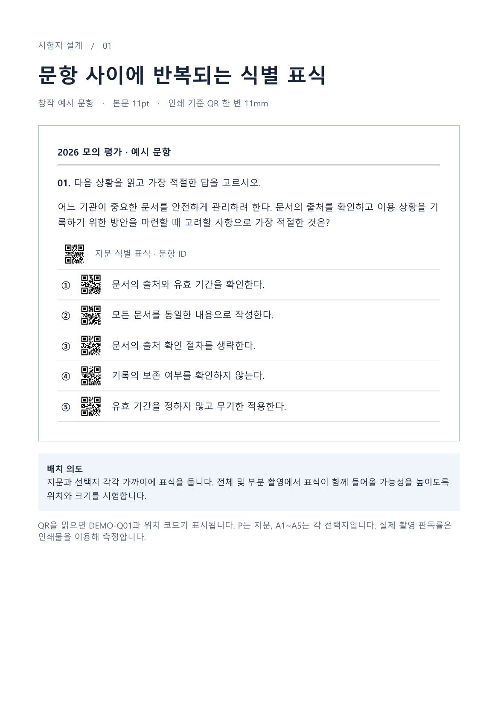
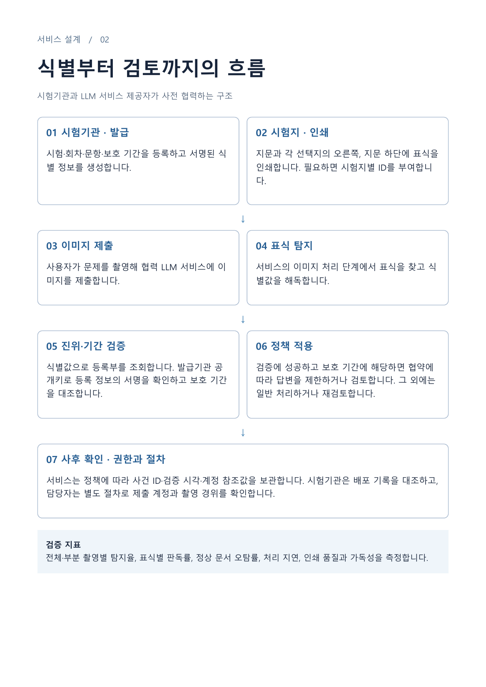

# 시험문항 촬영 이미지 식별

[한국어](README.md) · [English](en/README.md) · [简体中文](zh-CN/README.md) · [日本語](ja/README.md)

시험기관이 지문 하단과 객관식 번호 옆에 작은 표식을 반복 인쇄하고, 협력 AI 서비스가 제출된 사진에서 이를 읽어 시험 진행 여부를 확인하는 설계입니다. 첫 장은 실제 QR을 담은 모의 시험지, 둘째 장은 발급부터 사후 검토까지의 제안 구조입니다.

| 언어 | 시험지와 아키텍처 · A4 PDF | 설명문 |
| --- | --- | --- |
| 한국어 | [인쇄용 PDF](시험문항_식별_시안.pdf) | [아래 설명](#시험지-읽기) |
| English | [Print PDF](en/design.pdf) | [Design notes](en/README.md) |
| 简体中文 | [可打印 PDF](zh-CN/design.pdf) | [设计说明](zh-CN/README.md) |
| 日本語 | [印刷用 PDF](ja/design.pdf) | [設計の説明](ja/README.md) |

[한국어 편집용 HTML](시안_2장.html)

| 시험지 디자인 | 탐지·검증 아키텍처 |
| --- | --- |
|  |  |

## 시험지 읽기

PDF를 A4 용지에 실제 크기(100%)로 출력합니다. 본문은 11pt, QR은 흰 여백을 포함해 한 변 약 11mm입니다. 휴대전화 QR 판독기로 지문 하단을 읽으면 `DEMO-Q01-P`가 표시되고 각 선택지에서는 `DEMO-Q01-A1`부터 `DEMO-Q01-A5`까지 읽을 수 있습니다. 식별값은 오프라인에서 읽을 수 있는 예시 문자열입니다.

## 제안하는 서비스 흐름

시험기관은 짧은 식별값에 해당하는 시험 회차·문항·위치·보호 시작 및 종료 시각을 등록하고 등록 정보에 전자서명합니다. 시험지 배포본별 확인이 필요할 때는 별도 식별값과 배포 기록을 발급기관이 관리합니다. 예시 QR에는 수험자 이름이나 계정이 들어 있지 않습니다.

협력 서비스는 제출 이미지에서 한 개 이상의 표식을 찾고, 신뢰하는 발급기관의 등록부에서 식별값을 조회합니다. 공개키로 응답의 서명을 확인한 후 보호 기간과 서비스 정책에 따라 이용자 안내, 답변 제한 또는 담당자 검토를 적용합니다. 판독 실패, 미등록, 서명 오류와 보호 기간 종료는 별도 상태로 처리합니다. 서명은 등록 정보의 출처를 검증하며, 다른 문서에 표식을 복사한 경우에는 문항 대조 등 별도 확인이 필요합니다.

사후 검토에서는 서비스가 내부적으로 보관한 사건 시각과 제출 계정의 참조값을 확인합니다. 시험기관의 배포 기록과 서비스 계정 정보의 조회 권한·보존 기간·제공 절차를 사전에 합의해야 하며 실제 촬영자의 확인에는 추가 근거가 필요합니다. 이 저장소에서 구현한 범위는 인쇄용 시험지와 QR 식별값입니다. 등록부, 서명 검증, 계정 기록과 서비스 연동은 제안 단계입니다.

## 현재 검증과 실물 시험 계획

네 언어판 모두 A4 두 페이지임을 확인하고 각 판의 첫 장을 225dpi 회색조 이미지로 렌더링했습니다. 다음 결과는 네 언어판에서 동일했습니다. ZXing-C++은 전체 페이지에서 여섯 식별값을 읽었습니다. 표식별로 자른 여섯 이미지에서도 OpenCV가 각각의 식별값을 읽었습니다. 같은 전체 이미지에서는 OpenCV의 다중 QR 검출 결과가 0개였습니다. 디코더 선택에 따라 결과가 달라지며 휴대전화 실물 촬영 탐지율은 아직 측정 전입니다.

실물 시험에서는 전면 촬영, 지문만 촬영, 선택지 일부 촬영을 나누어 휴대전화 기종·거리·각도·조명·압축 조건을 기록합니다. 각 조건에서 전체 사진 수, 완전한 표식이 들어온 사진 수, 유효 식별값을 한 개 이상 읽은 사진 수를 기록해 포함률과 전체 탐지율을 구합니다. 정상 문서도 함께 시험해 오탐률을 집계하고 가독성과 처리 시간을 확인합니다.
