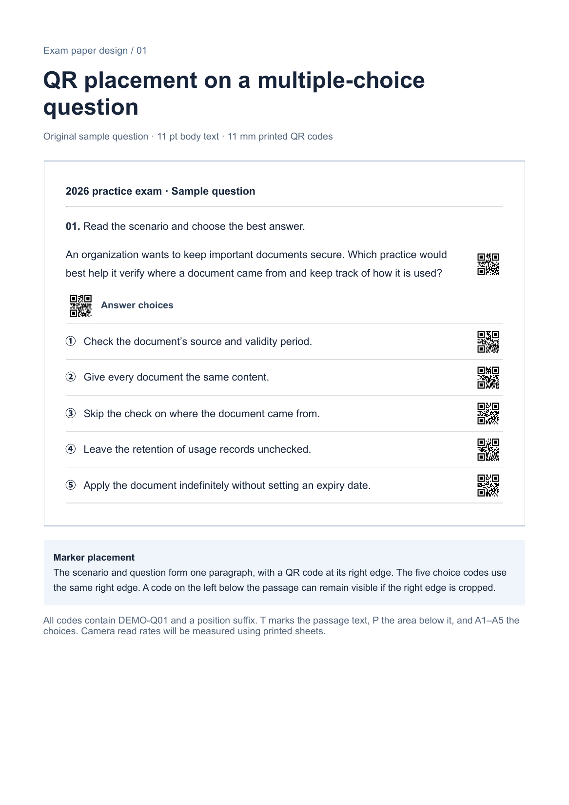
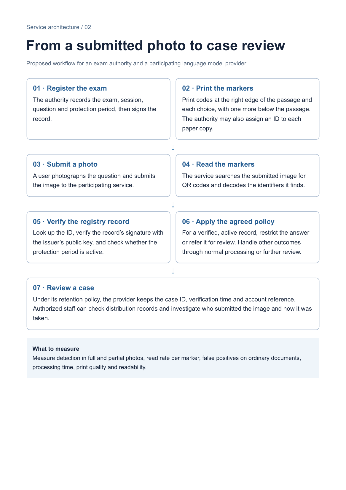

# Identifying exam questions in submitted photos

[한국어](../README.md) · [English](../en/README.md) · [简体中文](../zh-CN/README.md) · [日本語](../ja/README.md)

[Print the two-page PDF](design.pdf) · [Open the editable HTML source](design.html)

| Page 1 · Exam paper design | Page 2 · Verification workflow |
| --- | --- |
|  |  |

The first page shows a sample exam question. The passage reads as one paragraph, with a QR code at its right edge and another below. Each answer number sits directly beside its text, with a code at the far right of the row. The second page shows how a participating AI service could read a code in a submitted photo and check the exam’s protection period.

## Try the exam paper

Print on A4 at 100% scale. The body text is 11 pt. Each QR code measures about 11 mm per side, including its white border. The code at the right edge of the passage reads `DEMO-Q01-T`; the one below the passage on the left reads `DEMO-Q01-P`. The codes at the right ends of the answer rows read `DEMO-Q01-A1` through `DEMO-Q01-A5`. All seven identifiers can be read offline.

## How a participating service would verify a photo

The authority assigns a short identifier to each marked position. It records the exam session, question, position, and start and end of the protection period, then digitally signs the registry record. To distinguish individual printed copies, the authority could issue additional copy IDs and maintain a distribution record. The sample codes contain only question and position identifiers.

The service scans a submitted image for one or more codes. It looks up each identifier in a trusted issuer’s registry, verifies the record’s signature using the issuer’s public key and checks the protection period. Under the agreed policy, it could notify the user, restrict the answer or send the case for review. The design distinguishes an unreadable code, an unknown ID, a failed signature check and an expired protection period. The signature authenticates the registry record. A code can be copied to another document, so a reviewer may also need to match the photographed question to the registered item.

For a later review, authorized staff could look up the event time and an internal reference to the submitting account. The issuer and provider would first agree on access rights, retention periods and disclosure procedures for distribution and account records. Identifying the person who took a photograph requires additional evidence.

## Digital checks and print trial

All four editions fit on two A4 pages. We tested a 225 dpi grayscale rendering of each first page. ZXing-C++ read all seven identifiers from every full page. OpenCV read all seven individually cropped markers. On this edition’s full page, OpenCV’s multi-code detector read 0 of the seven. Both decoders read `DEMO-Q01-T` from the passage including its right edge, with the lower marker and answer rows excluded. A full-question photo can retain the lower-left marker even if the right edge is cut off. A passage-only crop that omits the right edge contains no QR code.

The print trial will compare full-question photos, passage crops with and without the right edge, and partial answer rows across phone models, lighting, distance and angle. Ordinary documents will be used to measure false positives. A reader trial will compare completion time, accuracy and reported discomfort for an unmarked paper, a center-marker layout and this right-edge layout. Both phone and reader trials are pending.
