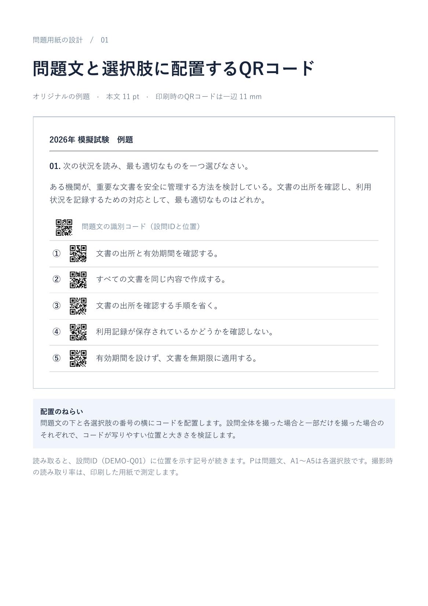

# 試験問題の撮影画像を識別するQRコード

[한국어](../README.md) · [English](../en/README.md) · [简体中文](../zh-CN/README.md) · [日本語](../ja/README.md)

[印刷用PDF（A4・全2ページ）](design.pdf) · [編集用HTML](design.html)

| 問題用紙の設計 | 検出・検証の流れ |
| --- | --- |
|  |  |

試験実施機関が問題文の下と各選択肢の番号の横に小さなQRコードを印刷し、提携するAIサービスが送信された画像からコードを読み取り、対象の設問が保護期間内かを照会する仕組みです。1ページ目は読み取り可能なQRコードを配置した模擬試験の例題、2ページ目は発行から事後確認までの運用案です。

## 試しに読み取る

PDFをA4用紙に「実際のサイズ」（倍率100%）で印刷します。本文は11 pt、QRコードは周囲の白い余白を含めて一辺約11 mmです。スマートフォンのQRコードリーダーで読み取ると、問題文の下のコードには `DEMO-Q01-P`、各選択肢のコードには `DEMO-Q01-A1` から `DEMO-Q01-A5` までの文字列が表示されます。これらのサンプル識別子はオフラインでも読み取れます。

## 提案する運用

試験実施機関は、短い識別子に実施回、設問、紙面上の位置、保護期間の開始・終了時刻を対応付け、登録情報に電子署名を付けます。配布した用紙を一部ずつ区別する必要があれば、発行機関が用紙別の識別子と配布記録を管理します。サンプルのQRコードに受験者の氏名やアカウント情報は含まれていません。

提携サービスは、送信された画像から一つ以上のコードを検出し、識別子を使って信頼できる発行機関の登録簿を照会します。事業者は応答に付いた署名を発行機関の公開鍵で検証し、保護期間と運用方針に応じて、利用者への案内、回答の制限、担当者による確認を行います。読み取り不能、未登録、署名エラー、保護期間終了はそれぞれ別の状態として扱います。電子署名で確認できるのは登録情報の出所です。コードが別の文書に複製された場合は、設問の内容を照合するなどの確認が必要です。

事後確認では、事業者が記録した時刻と送信元アカウントの参照情報を確認します。試験実施機関の配布記録と事業者のアカウント情報については、閲覧権限、保存期間、提供手続きを事前に取り決めます。実際に誰が撮影したかの確認には別の根拠が必要です。本試作で実装したのは、印刷可能な問題用紙とQRコードの識別子です。登録簿、署名の検証、アカウントの記録、サービスとの連携は設計段階です。

## 検証結果と実物での試験計画

4言語すべてのPDFがそれぞれA4判2ページであることを確認し、各版の1ページ目を225 dpiのグレースケール画像に変換しました。以下の結果は各言語版で共通です。ZXing-C++はページ全体から六つの識別子をすべて読み取りました。OpenCVはコードを個別に切り出した六つの画像をすべて読み取りましたが、同じページ全体に対する複数QRコードの一括検出では検出数が0でした。これらはデジタル画像での結果です。印刷した用紙をスマートフォンで撮影した場合の検出率は今後測定します。

実物での試験では、設問全体、問題文のみ、選択肢の一部をそれぞれ撮影し、端末の機種、距離、角度、照明、画像圧縮の条件を記録します。条件ごとに写真の総数、コード全体が写った写真の数、有効な識別子を一つ以上読み取れた写真の数を数え、全写真に対するコードの写り込み率と検出率を求めます。一般文書でも誤検出率を測り、紙面の読みやすさと処理時間を評価します。
