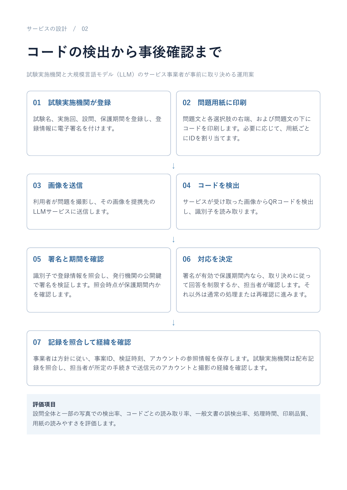

# 試験問題の撮影画像を識別するQRコード

[한국어](../README.md) · [English](../en/README.md) · [简体中文](../zh-CN/README.md) · [日本語](../ja/README.md)

[印刷用PDF（A4・全2ページ）](design.pdf) · [編集用HTML](design.html)

| 問題用紙の設計 | 検出・検証の流れ |
| --- | --- |
|  |  |

1ページ目は模擬試験の例題です。問題文は一つの段落にまとめ、段落の右端と直下にQRコードを一つずつ配置しました。各選択肢では番号のすぐ後に本文が続き、コードは行の右端にあります。2ページ目は、提携するAIサービスが送信された画像からコードを読み取り、設問が保護期間内かを照会する仕組みの提案です。

## 試しに読み取る

PDFをA4用紙に「実際のサイズ」（100%）で印刷します。本文は11 pt、QRコードは白い余白を含めて一辺約11 mmです。問題文の右端のコードは `DEMO-Q01-T`、問題文の下にある左側のコードは `DEMO-Q01-P` です。各選択肢の行の右端には順に `DEMO-Q01-A1` から `DEMO-Q01-A5` までが入っています。七つの識別子はすべてオフラインで読み取れます。

## 提案する運用

試験実施機関は、短い識別子に実施回、設問、紙面上の位置、保護期間の開始・終了時刻を対応付け、登録情報に電子署名を付けます。配布した用紙を一部ずつ区別する必要があれば、発行機関が用紙別の識別子と配布記録を管理します。サンプルのQRコードに受験者の氏名やアカウント情報は含まれていません。

提携サービスは、送信された画像から一つ以上のコードを検出し、識別子を使って信頼できる発行機関の登録簿を照会します。事業者は応答に付いた署名を発行機関の公開鍵で検証し、保護期間と運用方針に応じて、利用者への案内、回答の制限、担当者による確認を行います。読み取り不能、未登録、署名エラー、保護期間終了はそれぞれ別の状態として扱います。電子署名で確認できるのは登録情報の出所です。コードが別の文書に複製された場合は、設問の内容を照合するなどの確認が必要です。

事後確認では、事業者が記録した時刻と送信元アカウントの参照情報を確認します。試験実施機関の配布記録と事業者のアカウント情報については、閲覧権限、保存期間、提供手続きを事前に取り決めます。実際に誰が撮影したかの確認には別の根拠が必要です。本試作で実装したのは、印刷可能な問題用紙とQRコードの識別子です。登録簿、署名の検証、アカウントの記録、サービスとの連携は設計段階です。

## 検証結果と実物での試験計画

4言語版はいずれもA4判2ページです。各版の1ページ目を225 dpiのグレースケール画像に変換して調べました。ZXing-C++は各ページ全体から七つの識別子すべてを読み取り、OpenCVは個別に切り出した七つのコードをすべて読み取りました。この言語版でOpenCVの複数コード検出をページ全体に適用すると、七つのうち0個を読み取りました。 下のコードと選択肢を除き、右端を含めて問題文を切り出した画像では、両方の読み取りソフトが `DEMO-Q01-T` を検出しました。 設問全体を撮影した場合、右端を切っても問題文の下の左側のコードが残ることがあります。問題文だけを切り出して右端も除くと、画像にはコードが写りません。

実物での試験では、設問全体、右端まで含む問題文、右端を除いた問題文、選択肢の一部を撮影し、機種・照明・距離・角度ごとの読み取り率を調べます。一般文書での誤検出率も測定します。受験者による評価では、コードのない用紙、中央に置いた用紙、右端に置いた用紙を使い、解答時間・正答率・読みにくさを比較する予定です。実物のスマートフォン撮影と受験者による評価は未実施です。
