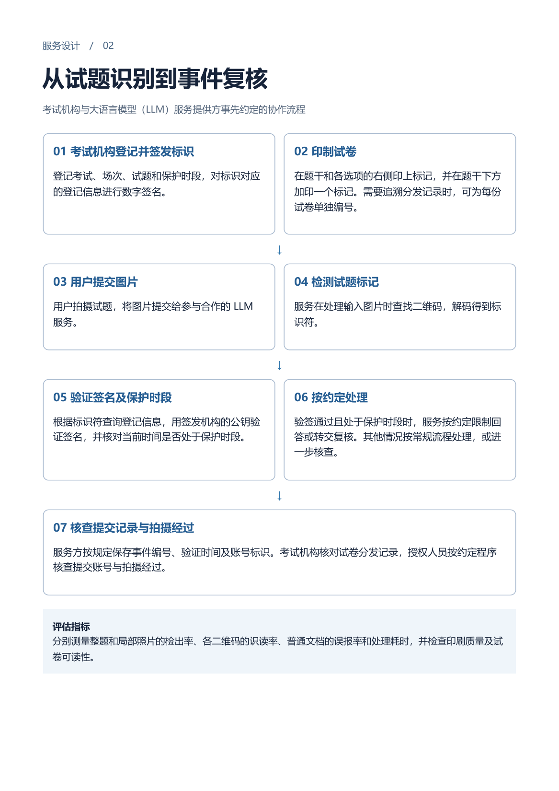

# 试题图像识别标记

[한국어](../README.md) · [English](../en/README.md) · [简体中文](../zh-CN/README.md) · [日本語](../ja/README.md)

[下载双页印刷版 PDF](design.pdf) · [查看可编辑的 HTML 源文件](design.html)

| 试卷上的二维码布局 | 检测与验证流程 |
| --- | --- |
|  |  |

第一页是一道模拟题。题干连续排成一个段落，段落右侧和下方各有一个二维码。每个选项的序号后紧接选项文字，二维码位于该行最右侧。第二页展示一项设计方案：合作的人工智能服务可从上传的照片中读取标识符，并查询试题是否处于保护时段。

## 打印与扫码

请用 A4 纸按实际大小（100%）打印。正文字号为 11 磅，二维码连同白边的边长约为 11 毫米。题干右侧的二维码对应 `DEMO-Q01-T`，题干下方左侧的二维码对应 `DEMO-Q01-P`，五个选项各行右端的二维码依次对应 `DEMO-Q01-A1` 至 `DEMO-Q01-A5`。七个标识符均可离线读取。

## 服务如何识别和处理试题

考试机构将考试场次、题号、标记位置以及保护时段的起止时间与标识符关联，并对登记信息进行数字签名。如需区分同一道题的不同分发副本，可为每份试卷另行编码，由考试机构保管分发记录。示例二维码不含考生姓名或服务账号信息。

合作服务从图片中读取一个或多个标识符，向受信任的签发机构查询登记信息，并用该机构的公钥验证返回信息的签名。根据保护时段和双方约定，服务可以提示用户、限制回答或转交人工复核。系统分别记录未能识读、标识符未登记、签名无效和保护期已过等状态。数字签名能验证登记信息的来源；如果有人把有效标记复制到其他文件上，还需核对题目内容。

事后复核时，服务方在其权限范围内核查事件时间与提交账号标识。双方需事先约定试卷分发记录和账号信息的访问权限、保存期限及提供程序。确定谁实际拍摄了照片，还需要其他证据。目前已制作可打印的试卷及二维码样例。登记服务、验签、账号事件记录和 LLM 服务接入均处于设计阶段。

## 已有验证与实拍测试计划

四个语言版本均为两页 A4。将各版第一页渲染为 225 dpi 灰度图后，ZXing-C++ 从每张整页图像中都读出了七个标识符；OpenCV 也从分别裁剪的七个标记中逐个读出了标识符。在本语言版本的整页图像上，OpenCV 的多码检测模式读出 0 个（共 7 个）。 仅截取题干段落并保留其右侧边缘，排除下方标记和选项后，两种解码器都读出了 `DEMO-Q01-T`。 整道题的照片即使裁去右侧，也可能保留题干下方左侧的二维码。如果只截取题干段落并裁掉右侧标记，截图中就没有二维码。

实拍测试将分别拍摄整道题、含右侧二维码的完整题干、裁去右侧的题干及部分选项，记录不同手机、光照、距离和角度下的识读率，并用普通文档测量误报率。考生测试将比较无标记、居中标记和右侧标记三种版式的答题时间、正确率及主观不适感。手机实拍和考生测试均尚未开展。
