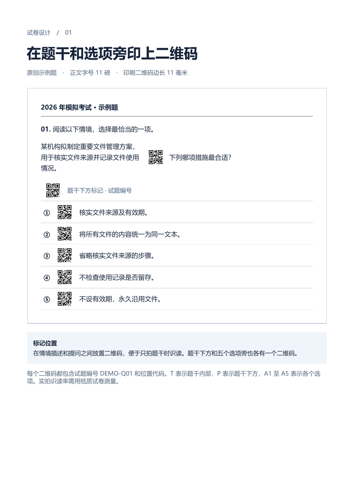

# 试题图像识别标记

[한국어](../README.md) · [English](../en/README.md) · [简体中文](../zh-CN/README.md) · [日本語](../ja/README.md)

[下载双页印刷版 PDF](design.pdf) · [查看可编辑的 HTML 源文件](design.html)

| 试卷上的二维码布局 | 检测与验证流程 |
| --- | --- |
|  |  |

在题干内、题干下方及五个选项的序号旁分别印上二维码，可以让参与合作的人工智能服务识别用户提交的试题图片，并查询试题是否处于保护时段。第一页是一道原创模拟题，含七个可识读的二维码。第二页展示考试机构与服务方从签发标识到事后复核的协作设计。

## 打印与扫码

请用 A4 纸按实际大小（100%）打印 PDF。正文字号为 11 磅，每个二维码连同周围白边的边长约为 11 毫米。题干内的二维码标为 `DEMO-Q01-T`，题干下方的二维码标为 `DEMO-Q01-P`，五个选项旁的二维码依次为 `DEMO-Q01-A1` 至 `DEMO-Q01-A5`。这些示例标识符可离线读取。

## 服务如何识别和处理试题

考试机构将考试场次、题号、标记位置以及保护时段的起止时间与标识符关联，并对登记信息进行数字签名。如需区分同一道题的不同分发副本，可为每份试卷另行编码，由考试机构保管分发记录。示例二维码不含考生姓名或服务账号信息。

合作服务从图片中读取一个或多个标识符，向受信任的签发机构查询登记信息，并用该机构的公钥验证返回信息的签名。根据保护时段和双方约定，服务可以提示用户、限制回答或转交人工复核。系统分别记录未能识读、标识符未登记、签名无效和保护期已过等状态。数字签名能验证登记信息的来源；如果有人把有效标记复制到其他文件上，还需核对题目内容。

事后复核时，服务方在其权限范围内核查事件时间与提交账号标识。双方需事先约定试卷分发记录和账号信息的访问权限、保存期限及提供程序。确定谁实际拍摄了照片，还需要其他证据。目前已制作可打印的试卷及二维码样例。登记服务、验签、账号事件记录和 LLM 服务接入均处于设计阶段。

## 已有验证与实拍测试计划

四种语言的 PDF 均为两页 A4。我们将每个版本的第一页渲染为 225 dpi 灰度图，ZXing-C++ 从每张整页图像中读出了全部七个标识符。OpenCV 逐个识读七张单码裁剪图时全部成功，使用多码检测模式扫描整页时检出 0 个。仅截取题干正文、排除题干下方的二维码和选项后，ZXing-C++ 和 OpenCV 均从四个版本的截图中读出了题干内的标识符 `DEMO-Q01-T`。纸质试卷在手机实拍条件下的识读率仍待测量。

实拍测试分为整道题、仅题干和部分选项三种取景方式，并记录手机型号、拍摄距离、角度、光照和图片压缩条件。每种条件下分别统计照片总数、含至少一个完整标记的照片数及成功读出至少一个有效标识符的照片数，据此计算标记入镜率和整体检出率。同时用普通文档测量误报率，并评估试卷可读性与处理耗时。
